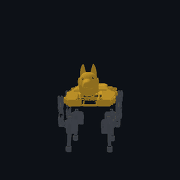
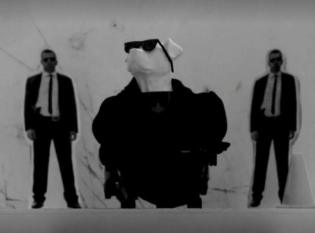
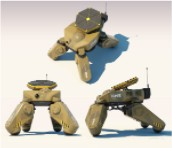
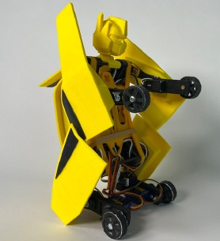
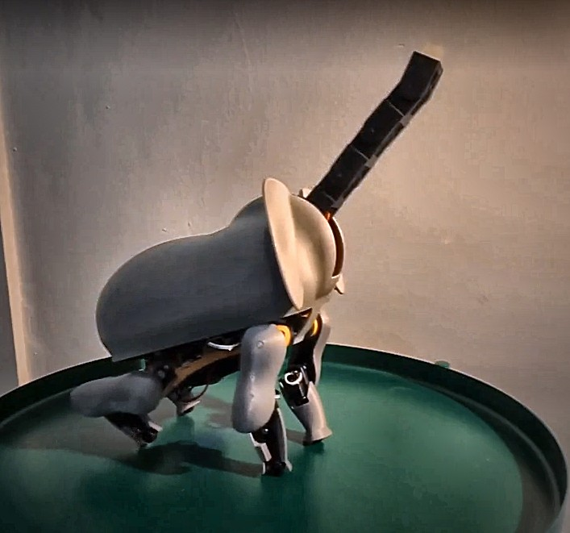
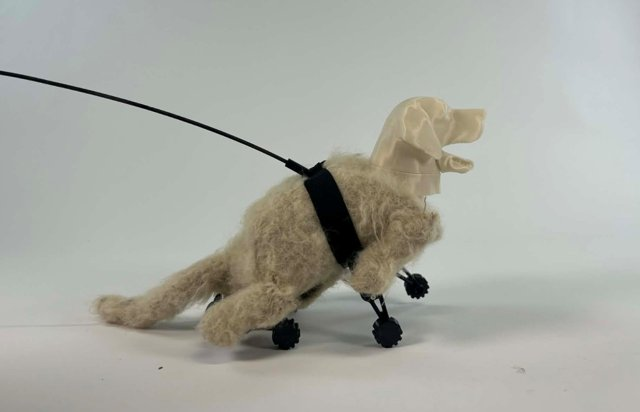

# Product Development · Technology-Driven Design

Student projects and course software of the **Technology-Driven Design** practicum (Master Product Development, University of Antwerp).
Each year, teams upgrade an open-source robot, the [Petoi Bittle](https://www.petoi.com/pages/bittle-open-source-bionic-robot-dog) robot dog, with their own hardware, software and ideas.

 

## 🛠️ Software we develop and recommend

Tools made for this course. Start here if you are a student.

| | Project | What it is |
|---|---|---|
| 🐕 | **[Bittle Studio](https://github.com/UA-ProductDevelopment-TDD/Bittle_Studio)** | Design, simulate and send motions to the Bittle: a motion timeline, a 3D physics simulation (PyBullet) and a Bluetooth console for the real robot. Runs on your own computer. |
| 🎮 | **[Bittle Link](https://ua-productdevelopment-tdd.github.io/Bittle_Studio/bittle-link/)** | The robot console from Bittle Studio, in your browser: connect over Bluetooth, drive gaits, play skills. Nothing to install (Chrome or Edge). |
| 🧩 | **[Bittle URDF](https://github.com/UA-ProductDevelopment-TDD/Bittle_URDF)** | A simulation-ready URDF model of the Bittle X, prepared for physics simulators. |
| ⚙️ | **[OpenCat ESP32 firmware](https://github.com/UA-ProductDevelopment-TDD/OpenCatEsp32-Quadruped-Robot)** | Our fork of Petoi's open-source firmware for the BiBoard (ESP32), the Bittle X's controller. |

## 🚀 Student projects 2026–2027

| Team | Project |
|---|---|
| [Groep 1](https://github.com/UA-ProductDevelopment-TDD/2026_Groep_1) | *Coming soon* |
| [Groep 2](https://github.com/UA-ProductDevelopment-TDD/2026_Groep_2) | *Coming soon* |
| [Groep 3](https://github.com/UA-ProductDevelopment-TDD/2026_Groep_3) | *Coming soon* |
| [Groep 4](https://github.com/UA-ProductDevelopment-TDD/2026_Groep_4) | *Coming soon* |
| [Groep 5](https://github.com/UA-ProductDevelopment-TDD/2026_Groep_5) | *Coming soon* |
| [Groep 6](https://github.com/UA-ProductDevelopment-TDD/2026_Groep_6) | *Coming soon* |
| [Groep 7](https://github.com/UA-ProductDevelopment-TDD/2026_Groep_7) | *Coming soon* |

## 📚 Student projects 2025–2026

| Team | Project | Picture |
|---|---|---|
| [Groep 1](https://github.com/UA-ProductDevelopment-TDD/2025_Groep_1) | **Pitbull on stage**: a Bittle with a 3D-printed pitbull head and sunglasses that follows a line with AI vision onto a laser-cut stage, then performs a dance routine with a microphone |  |
| [Groep 2](https://github.com/UA-ProductDevelopment-TDD/2025_Groep_2) | **RobotDawg (WarDog)**: a camouflaged combat Bittle, driven from a browser HUD with a live AI-camera feed, a ToF radar scanner and a disc shooter that only fires when the AI spots a target |  |
| [Groep 3](https://github.com/UA-ProductDevelopment-TDD/2025_Groep_3) | **Bumblebee**: a Bittle that transforms from a yellow car into a robot at the press of a button, with printed panels, wheel servos and an Arduino that sends it commands |  |
| [Groep 4](https://github.com/UA-ProductDevelopment-TDD/2025_Groep_4) | **Bittle Day Planner**: an elephant-dressed Bittle linked to a planner web app; it celebrates when you finish a task and gets grumpy when one is overdue |  |
| [Groep 5](https://github.com/UA-ProductDevelopment-TDD/2025_Groep_5) | **Bella**: "more dog, less robot", a 3D-printed Bittle with a soft coat, a turning head, a mouth that opens, a wagging tail, and a leash you can walk her with |  |

---

Team repositories are named `<year>_Groep_<n>`, after the academic year they start in.
